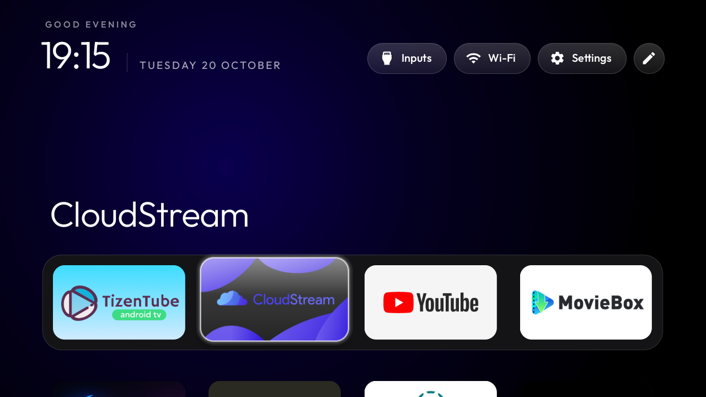
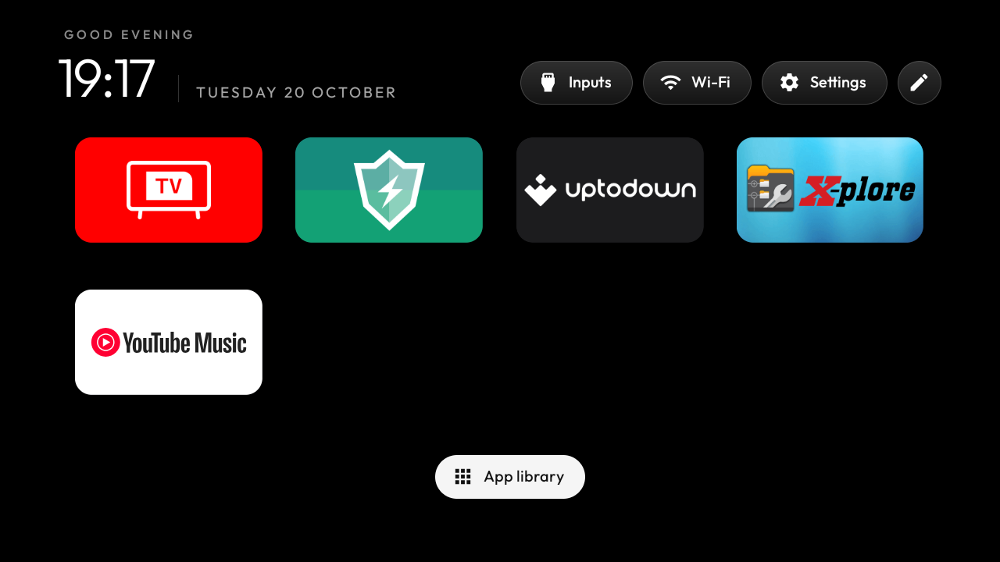
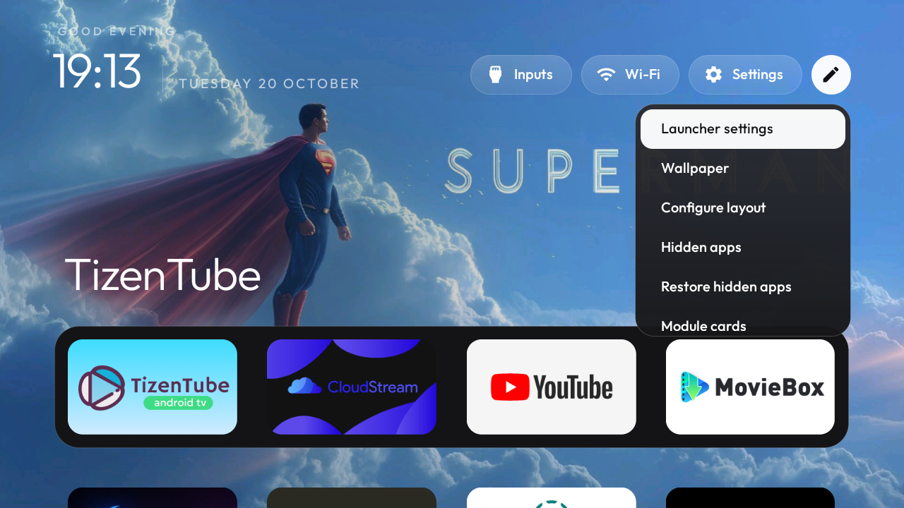
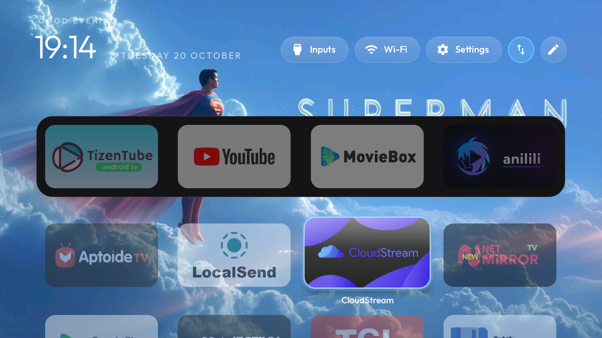
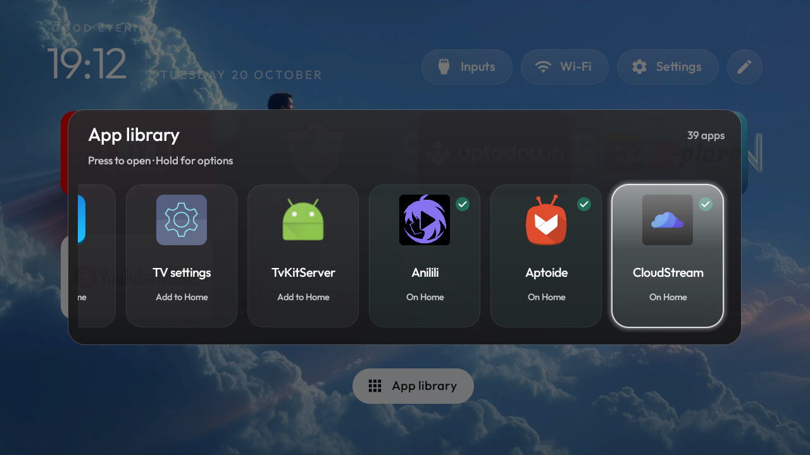
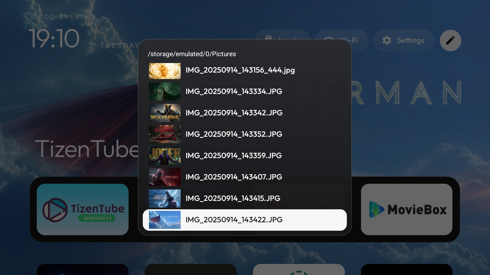
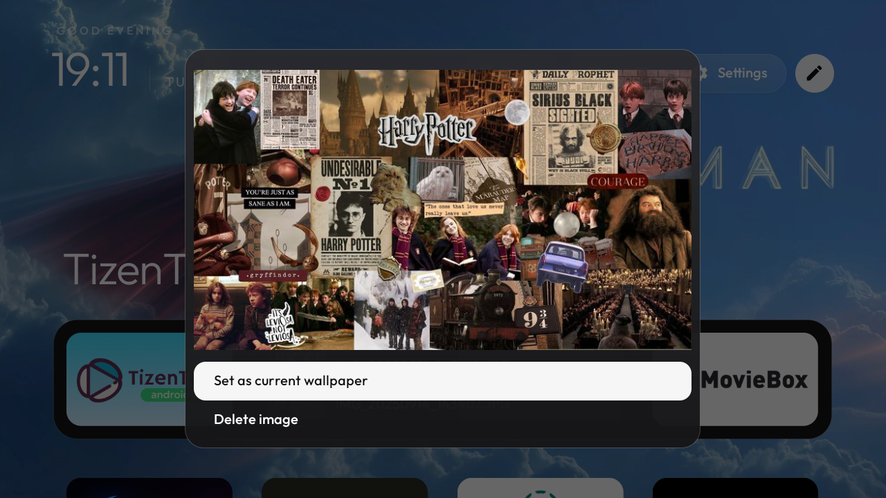
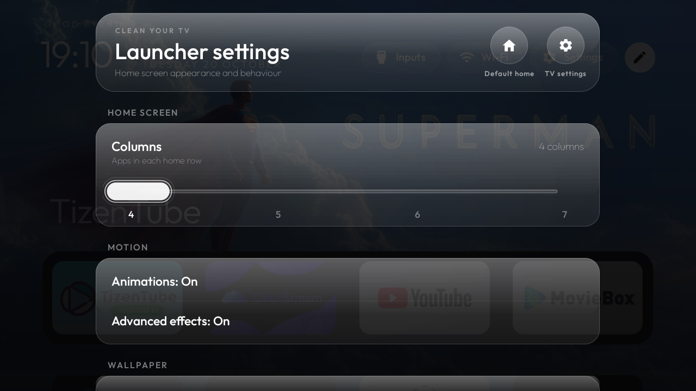

# Velvet Home

An ad-free, Apple TV-style home screen for Android TV. **393 KB.** No ads, no telemetry, no bloat.

Built on [CleanYourTV](https://github.com/Gathin23/cleanyourtv) (MIT) and extended with a glass UI, a wallpaper engine and an in-app image browser.

---

## Screenshots

| Home, over your own wallpaper | Home, minimal |
|---|---|
|  |  |

**The pencil menu** — one place for everything:



| Layout editing | App library |
|---|---|
|  |  |

| Wallpaper browser | Image preview |
|---|---|
|  |  |

**Launcher settings** — a translucent glass page that floats over Home:



---

## Features

- **Apple TV-style home** — big clock, date, dock with a springing glass highlight
- **Screensaver-free** — no ads, no recommendations, no sponsored rows
- **App library** — every installed app, TV or phone, with add-to-home / hide toggles
- **Layout editing** — move tiles with the D-pad; hide without uninstalling
- **Wallpaper engine** — use an image, or rotate a whole folder on an interval
- **In-app browser** — folders and image thumbnails at their true aspect ratio, no file-manager required
- **Image preview** — set as wallpaper or delete, without leaving the launcher
- **Glass UI throughout** — menus, dialogs and settings share one material

## Install

```bash
adb install -r velvet-home-v1.0.apk
adb shell cmd package set-home-activity com.gathin.tvhome/.MainActivity
```

Requires **Android 8.0+** (minSdk 26). Tested on a TCL Android TV (API 28).

## Size

| | |
|---|---|
| APK | **393,466 bytes (384 KB)** |
| Launcher original | 374,957 bytes (366 KB) |
| Overhead for everything above | **+5.0%** |

## Credits

Forked from [CleanYourTV](https://github.com/Gathin23/cleanyourtv) by Gathin23, MIT licensed. The launcher, glass material and motion system build on that work.
